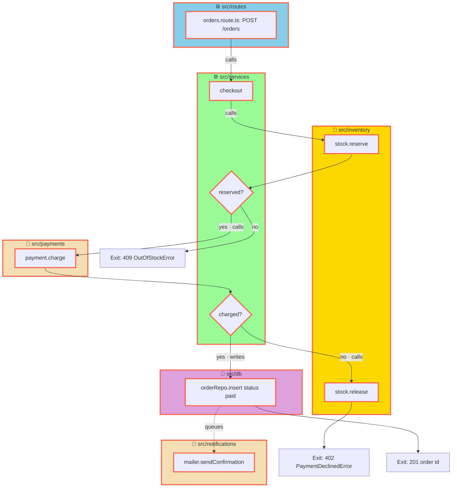

# Order checkout

## 1. Requirement
- Customer places an order for items in the cart (`POST /orders`).
- Order only goes through when every item is in stock.
- Card is charged once through the payment gateway.
- Payment declined → no order, stock goes back.
- Paid order is stored and its id returned.
- Customer gets a confirmation email after payment.

## 2. Understanding

**Current**
- None — sample greenfield service (`src/routes`, `src/services`, `src/inventory`, `src/payments`, `src/db`).

**To do**
- §1 place order → `POST /orders` in `src/routes/orders.route.ts` — validate body, call `checkout()`, map errors to 409 / 402.
- §1 in stock → `stock.reserve(items)` in `src/inventory/stock.service.ts` — atomic decrement, throws `OutOfStockError`.
- §1 charge once → `payment.charge(total, cardToken, idempotencyKey)` in `src/payments/payment.client.ts` — idempotency key = cart id.
- §1 declined → `checkout()` catches `PaymentDeclinedError`, calls `stock.release(items)`, rethrows.
- §1 stored → `orderRepo.insert({ status: "paid" })` in `src/db/order.repo.ts`, return order id.
- §1 confirmation email → `mailer.sendConfirmation(order)` in `src/notifications/mailer.ts`, queued after insert — never blocks the 201.

**Constraints**
- Out of scope: refunds, partial shipments, guest checkout.
- Assumption: payment gateway supports idempotency keys.

## 3. Files to create

```
src/
├── routes/orders.route.ts         ← entry: POST /orders
├── services/
│   ├── checkout.service.ts        ← orchestrator
│   └── checkout.service.test.ts
├── inventory/stock.service.ts
├── payments/payment.client.ts
├── db/order.repo.ts
└── notifications/mailer.ts
```

## 4. Files to change
None

## 5. Files to remove
None

## 6. How it works

### Before (current flow)
None

### After (planned flow)



### Diagram (archify)
| Type | Why | Source |
|---|---|---|
| workflow | Steps, the two decision points, three exits and the queued email of checkout | .archify/order-checkout/workflow.json |
| sequence | Calls between route, checkout, stock, gateway and DB in time order, incl. the release-on-decline path | .archify/order-checkout/sequence.json |

## 7. Steps
1. **stock-reserve** — `reserve(items)` / `release(items)` with atomic decrement.
2. **payment-client** — `charge(total, cardToken, idempotencyKey)`; map gateway decline to `PaymentDeclinedError`.
3. **order-repo** — `insert(order)` returning id.
4. **checkout-service** — reserve → charge → insert; release on decline.
5. **orders-route** — `POST /orders`, 201 / 409 / 402.
6. **checkout-tests** — in-stock, out-of-stock, payment-declined.
7. **confirmation-email** — `sendConfirmation(order)`, queued after insert.

## 8. Grilling Q&A

| Question | Answer |
|---|---|
| Reserve stock before or after charging? | Before — *assumed* (avoid charging for unavailable items) |
| Double-submit protection? | Gateway idempotency key = cart id — *assumed* |
| Payment declined: keep a failed order row? | No row, release stock — *assumed* |
| Diagram types? | workflow (primary) + sequence — *assumed* |
| Email sync or queued? | Queued after insert, 201 not blocked — *assumed* |

---
Plan saved at: /Users/krisada/Desktop/Skills/docs/examples/order-checkout.plan.md
